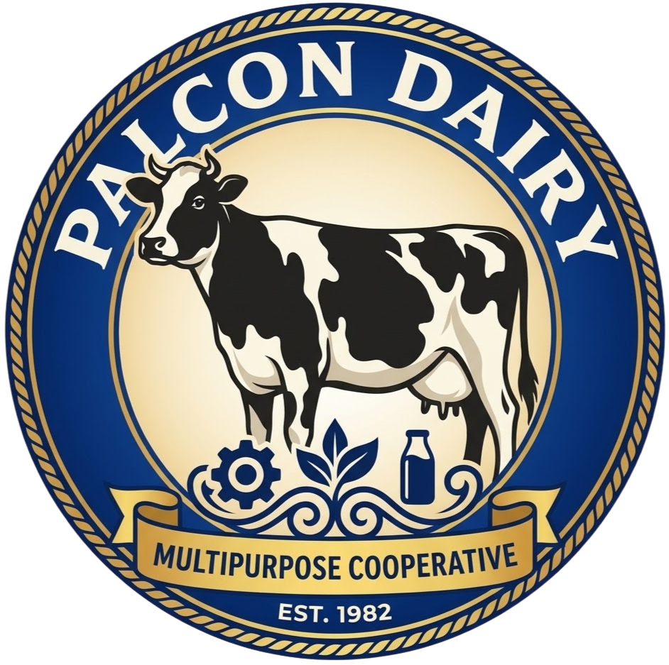
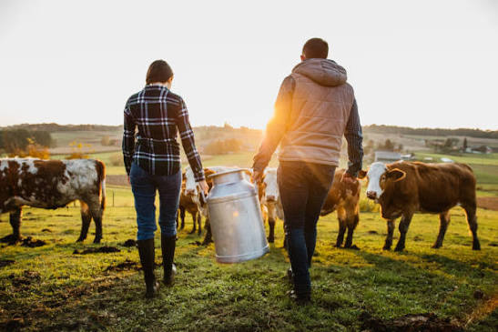

<!DOCTYPE html>
<html lang="en" class="scroll-smooth">
<head>
    <meta charset="UTF-8">
    <meta name="viewport" content="width=device-width, initial-scale=1.0">
    <title>Palcon Dairy Multipurpose Cooperative - Kooperatiba ng Gatas</title>
    <!-- Tailwind CSS -->
    
    
    <!-- Lucide Icons -->
    

    <!-- Google Fonts: Montserrat & Inter -->
    <link rel="preconnect" href="https://fonts.googleapis.com">
    <link rel="preconnect" href="https://fonts.gstatic.com" crossorigin>
    <link href="https://fonts.googleapis.com/css2?family=Montserrat:wght@400;500;600;700;800;900&display=swap" rel="stylesheet">

    
</head>
<body class="bg-slate-50 text-slate-800 min-h-screen flex flex-col selection:bg-emerald-200">

    <!-- MAIN HEADER & NAVIGATION -->
    <header class="glass-header text-white sticky top-0 z-50 shadow-md">
        

            

                <!-- Brand Logo & Name -->
                

                    
                    

                        Palcon Dairy Multi-purpose Cooperative
                        Kooperatiba ng Gatas
                    

                

                <!-- Desktop Navigation Links -->
                <nav class="hidden lg:flex items-center space-x-1 xl:space-x-2">
                    <button onclick="showPage('home')" id="nav-home" class="nav-btn px-3 py-2 text-xs font-semibold rounded-lg hover:bg-emerald-700/60 transition" data-i18n="navHome">Home</button>
                    <button onclick="showPage('about')" id="nav-about" class="nav-btn px-3 py-2 text-xs font-semibold rounded-lg hover:bg-emerald-700/60 transition" data-i18n="navAbout">About Us</button>
                    <button onclick="showPage('products')" id="nav-products" class="nav-btn px-3 py-2 text-xs font-semibold rounded-lg hover:bg-emerald-700/60 transition" data-i18n="navProducts">Products & Services</button>
                    <button onclick="showPage('gallery')" id="nav-gallery" class="nav-btn px-3 py-2 text-xs font-semibold rounded-lg hover:bg-emerald-700/60 transition" data-i18n="navGallery">Gallery</button>
                    <button onclick="showPage('youth')" id="nav-youth" class="nav-btn px-3 py-2 text-xs font-semibold rounded-lg hover:bg-emerald-700/60 transition" data-i18n="navYouth">Youth Hub</button>
                    <button onclick="showPage('contact')" id="nav-contact" class="nav-btn px-3 py-2 text-xs font-semibold rounded-lg hover:bg-emerald-700/60 transition" data-i18n="navContact">Contact Us</button>
                    <button onclick="showPage('store')" id="nav-store" class="nav-btn px-3 py-2 text-xs font-semibold rounded-lg hover:bg-emerald-700/60 transition flex items-center gap-1.5" data-i18n="navStore">
                        Coop Store
                        0
                    </button>
                </nav>

                <!-- Right Side Tools: Language Switcher & Portal Login CTA -->
                

                    <button onclick="toggleLanguage()" class="flex items-center gap-1.5 bg-emerald-700/70 hover:bg-emerald-600 text-xs px-3 py-2 rounded-xl border border-emerald-500/40 transition">
                        <i data-lucide="globe" class="w-4 h-4"></i>
                        Filipino
                    </button>

                    

                        <!-- Populated by JS (Portal Button or User Profile) -->
                    

                    <!-- Mobile Menu Toggle Button -->
                    <button onclick="toggleMobileMenu()" class="lg:hidden p-2 rounded-xl bg-emerald-700/60 hover:bg-emerald-600 border border-emerald-500/40 transition">
                        <i data-lucide="menu" class="w-5 h-5"></i>
                    </button>
                

            

        

        <!-- Mobile Navigation Menu Dropdown -->
        

            <button onclick="showPage('home')" class="block w-full text-left py-2 px-3 rounded-lg hover:bg-emerald-800 text-sm font-medium" data-i18n="navHome">Home</button>
            <button onclick="showPage('about')" class="block w-full text-left py-2 px-3 rounded-lg hover:bg-emerald-800 text-sm font-medium" data-i18n="navAbout">About Us</button>
            <button onclick="showPage('products')" class="block w-full text-left py-2 px-3 rounded-lg hover:bg-emerald-800 text-sm font-medium" data-i18n="navProducts">Products & Services</button>
            <button onclick="showPage('gallery')" class="block w-full text-left py-2 px-3 rounded-lg hover:bg-emerald-800 text-sm font-medium" data-i18n="navGallery">Gallery & Projects</button>
            <button onclick="showPage('youth')" class="block w-full text-left py-2 px-3 rounded-lg hover:bg-emerald-800 text-sm font-medium" data-i18n="navYouth">Youth Hub</button>
            <button onclick="showPage('contact')" class="block w-full text-left py-2 px-3 rounded-lg hover:bg-emerald-800 text-sm font-medium" data-i18n="navContact">Contact Us</button>
            <button onclick="showPage('store')" class="block w-full text-left py-2 px-3 rounded-lg hover:bg-emerald-800 text-sm font-medium" data-i18n="navStore">Coop Store</button>
            <button onclick="showPage('portal')" class="block w-full text-center py-2.5 px-3 rounded-xl bg-amber-500 text-slate-900 font-bold text-sm" data-i18n="btnMemberPortal">Member Portal</button>
        

    </header>

    <!-- SECONDARY PORTAL SUB-HEADER (Visible only inside Member Portal view) -->
    

        

            

                

                    Member Portal Active
                    Welcome, Member!
                

                

                    <button onclick="switchPortalTab('dashboard')" id="ptab-dashboard" class="portal-tab px-3 py-1.5 rounded-lg bg-white/20 text-white" data-i18n="pNavDash">Dashboard</button>
                    <button onclick="switchPortalTab('savings')" id="ptab-savings" class="portal-tab px-3 py-1.5 rounded-lg hover:bg-white/10" data-i18n="pNavSavings">Savings & Withdraw</button>
                    <button onclick="switchPortalTab('loans')" id="ptab-loans" class="portal-tab px-3 py-1.5 rounded-lg hover:bg-white/10" data-i18n="pNavLoans">Micro-Loans</button>
                

            

        

    

    <!-- MAIN CONTENT CONTAINER -->
    <main class="flex-grow">

        <!-- 1. HOME PAGE SECTION -->
        <section id="page-home" class="page-view space-y-16">
            <!-- Hero Banner -->
            

                <!-- Background Image with Overlay -->
                

                    
                    <!-- Dark Green Overlay for High Text Readability -->
                    

                

                <!-- Soft Ambient Glow -->
                

                <!-- Main Content Container -->
                

                    

                        

                            
                                <i data-lucide="shield-check" class="w-4 h-4 text-amber-400"></i>
                                CDA Accredited Primary Dairy Cooperative
                            
                            <h1 class="text-3xl sm:text-5xl font-extrabold tracking-tight leading-tight" data-i18n="heroTitle">
                                Empowering Local Dairy Farmers & Enriching Philippine Communities
                            </h1>
                            

                                Palcon Dairy Multi-purpose Cooperative brings together smallholder dairy farmers, offering fair milk pricing, modern cattle feeding, accessible micro-loans, savings options, and youth agri-entrepreneurship programs.
                            

                            

                                <button onclick="showPage('portal')" class="bg-amber-500 hover:bg-amber-400 text-slate-900 font-bold px-6 py-3.5 rounded-xl shadow-lg transition flex items-center gap-2 text-sm">
                                    <i data-lucide="user-check" class="w-4 h-4"></i>
                                    Member Portal & Services
                                </button>
                                <button onclick="showPage('store')" class="bg-white/10 hover:bg-white/20 border border-white/20 text-white font-semibold px-6 py-3.5 rounded-xl transition flex items-center gap-2 text-sm">
                                    <i data-lucide="shopping-bag" class="w-4 h-4"></i>
                                    Explore Coop Store & Feeds
                                </button>
                            

                        

                        

                            

                                

                                    
🐄

                                    

                                        <h3 class="font-bold text-lg text-white" data-i18n="heroStatHeading">Fresh Milk Daily Hub</h3>
                                        
Collection & Quality Processing Center

                                    

                                

                                

                                    

                                        
1,250+ L

                                        
Daily Milk Collected

                                    

                                    

                                        
₱45.00/L

                                        
Guaranteed Payout Rate

                                    

                                

                            

                        

                    

                

            

            <!-- Stats Counter Bar -->
            

                

                    

                        
450+

                        
Active Dairy Farmers

                    

                    

                        
38,000 L

                        
Monthly Fresh Milk

                    

                    

                        
₱12.5M

                        
Cooperative Share Equity

                    

                    

                        
180+

                        
Youth Agri Members

                    

                

            

            <!-- Key Cooperative Features Highlight -->
            

                

                    <h2 class="text-2xl sm:text-3xl font-bold text-slate-900" data-i18n="servicesHeading">Complete Cooperative Support System</h2>
                    
Providing total care for cattle farmers, farm inputs, micro-loans, and household food security.

                

                

                    

                        

                            <i data-lucide="hand-coins" class="w-6 h-6"></i>
                        

                        <h3 class="font-bold text-slate-800 text-lg mb-2" data-i18n="featLoansTitle">Micro-Loans & Savings</h3>
                        
Easy access to cattle purchase loans, feed loans, and high-interest savings with flexible payout options via GCash, Bank, or Cash Pickup.

                    

                    

                        

                            <i data-lucide="shopping-cart" class="w-6 h-6"></i>
                        

                        <h3 class="font-bold text-slate-800 text-lg mb-2" data-i18n="featStoreTitle">Coop Feeds & Store</h3>
                        
Discounted high-protein cattle feeds, corn silage, mineral blocks, alongside rice and essential household groceries for farming families.

                    

                    

                        

                            <i data-lucide="sparkles" class="w-6 h-6"></i>
                        

                        <h3 class="font-bold text-slate-800 text-lg mb-2" data-i18n="featYouthTitle">Youth in Dairy Program</h3>
                        
Educational hub, quiz games, and training designed to empower young Filipinos to lead modern dairy enterprises.

                    

                

            

        </section>

        <!-- 2. ABOUT US PAGE SECTION -->
        <section id="page-about" class="page-view hidden py-10">
            

                

                    Who We Are
                    <h1 class="text-3xl font-extrabold text-slate-900 mt-3" data-i18n="aboutHeading">Building a Sustainable Dairy Industry in the Philippines</h1>
                    
Established to unite local milk producers, Palcon Dairy Multi-purpose Cooperative serves as a community-driven cooperative committed to financial stability, high milk quality standards, and youth empowerment.

                

                <!-- Mission, Vision, Values -->
                

                    

                        

                            <i data-lucide="target" class="w-5 h-5"></i>
                        

                        <h3 class="font-bold text-lg mb-2" data-i18n="missionTitle">Our Mission</h3>
                        
To uplift dairy farming families by providing reliable milk collection, accessible capital micro-financing, affordable cattle nutrition, and continuous technical training.

                    

                    

                        

                            <i data-lucide="eye" class="w-5 h-5"></i>
                        

                        <h3 class="font-bold text-lg mb-2" data-i18n="visionTitle">Our Vision</h3>
                        
To become a premier Philippine dairy cooperative producing top-quality milk products, securing food independence, and creating vibrant rural livelihoods.

                    

                    

                        

                            <i data-lucide="heart" class="w-5 h-5"></i>
                        

                        <h3 class="font-bold text-slate-800 text-lg mb-2" data-i18n="valuesTitle">Core Values</h3>
                        
Pagtutulungan (Cooperation), Katapatan (Integrity), Kaunlaran (Progress), and Service to the Filipino Youth.

                    

                

                <!-- Board of Directors / Leadership Grid -->
                

                    <h3 class="text-xl font-bold text-slate-900 mb-6 text-center" data-i18n="leadershipHeading">Cooperative Leadership Board</h3>
                    

                        

                            
EC

                            <h4 class="font-bold text-slate-800 text-sm">Engr. Ernesto Cruz</h4>
                            
Cooperative Chairman

                        

                        

                            
DR

                            <h4 class="font-bold text-slate-800 text-sm">Dr. Rosa Santos</h4>
                            
Head Vet & Quality Assurance

                        

                        

                            
MR

                            <h4 class="font-bold text-slate-800 text-sm">Manuel Reyes</h4>
                            
Finance & Credit Committee

                        

                        

                            
AM

                            <h4 class="font-bold text-slate-800 text-sm">Angela Mercado</h4>
                            
Youth Program Coordinator

                        

                    

                

            

        </section>

        <!-- 3. PRODUCTS & SERVICES PAGE SECTION -->
        <section id="page-products" class="page-view hidden py-10">
            

                

                    <h1 class="text-3xl font-extrabold text-slate-900" data-i18n="prodPageTitle">Cooperative Products & Services</h1>
                    
Pure local dairy products processed fresh daily, along with member services.

                

                <!-- Products Display Grid -->
                

                    

                        

                            
🥛

                            Fresh Milk
                            <h3 class="font-bold text-slate-800 text-base mt-2">Pure Fresh Carabao / Cow Milk</h3>
                            
100% natural pasteurized milk collected from verified co-op dairy farms.

                        

                        

                            ₱110.00 / Liter
                            <button onclick="showPage('store')" class="bg-emerald-700 hover:bg-emerald-800 text-white text-xs font-semibold px-3 py-1.5 rounded-lg transition" data-i18n="orderInStore">Order in Store</button>
                        

                    

                    

                        

                            
🧀

                            Artisanal
                            <h3 class="font-bold text-slate-800 text-base mt-2">Traditional Kesong Putih</h3>
                            
Fresh soft white cheese made from pure Carabao milk and sea salt.

                        

                        

                            ₱160.00 / 200g
                            <button onclick="showPage('store')" class="bg-emerald-700 hover:bg-emerald-800 text-white text-xs font-semibold px-3 py-1.5 rounded-lg transition" data-i18n="orderInStore">Order in Store</button>
                        

                    

                    

                        

                            
🐮

                            Farm Service
                            <h3 class="font-bold text-slate-800 text-base mt-2">Artificial Insemination & Breeding</h3>
                            
Veterinary genetics program to improve dairy yield for member cattle.

                        

                        

                            Member Subsidized
                            <button onclick="showPage('contact')" class="bg-emerald-700 hover:bg-emerald-800 text-white text-xs font-semibold px-3 py-1.5 rounded-lg transition" data-i18n="inquireService">Inquire Service</button>
                        

                    

                

            

        </section>

        <!-- 4. GALLERY & PROJECTS PAGE SECTION -->
        <section id="page-gallery" class="page-view hidden py-10">
            

                

                    <h1 class="text-3xl font-extrabold text-slate-900" data-i18n="galleryTitle">Cooperative Gallery & Projects</h1>
                    
Highlights from local dairy farms, milk processing plants, and youth workshops.

                

                

                    

                        
🏭

                        

                            Community Hub
                            <h3 class="font-bold text-slate-800 text-sm mt-2">Modern Milk Chilling Station</h3>
                            
Equipped with 2,000L cold storage to preserve raw milk quality before transport.

                        

                    

                    

                        
🌾

                        

                            Farm Feeds
                            <h3 class="font-bold text-slate-800 text-sm mt-2">Silage Production Drive</h3>
                            
Coop members producing fermented feed bags for dry-season cattle nutrition.

                        

                    

                    

                        
🎓

                        

                            Youth Education
                            <h3 class="font-bold text-slate-800 text-sm mt-2">Kabataan sa Agrikultura Workshop</h3>
                            
Training youth in modern dairy herd management and milk product marketing.

                        

                    

                

            

        </section>

        <!-- 5. CONTACT US PAGE SECTION -->
        <section id="page-contact" class="page-view hidden py-10">
            

                

                    <h1 class="text-3xl font-extrabold text-slate-900" data-i18n="contactTitle">Contact Cooperative Office</h1>
                    
Have questions regarding membership, milk supply, or loans? Send us a message.

                

                

                    <!-- Office Information Card -->
                    

                        <h3 class="font-bold text-lg border-b border-emerald-800 pb-3" data-i18n="officeInfo">Coop Office Info</h3>
                        

                            

                                <i data-lucide="map-pin" class="w-5 h-5 text-amber-400 shrink-0 mt-0.5"></i>
                                Palcon Cooperative Processing Plant, Main Highway, Victoria, Laguna, Philippines
                            

                            

                                <i data-lucide="phone" class="w-5 h-5 text-amber-400 shrink-0"></i>
                                +63 (049) 555-0192 / +63 917 123 4567
                            

                            

                                <i data-lucide="mail" class="w-5 h-5 text-amber-400 shrink-0"></i>
                                info@palcondairy.coop
                            

                            

                                <i data-lucide="clock" class="w-5 h-5 text-amber-400 shrink-0"></i>
                                Mon - Sat: 7:00 AM - 5:00 PM
                            

                        

                    

                    <!-- Contact Form (Connected to Google Sheets backend) -->
                    

                        <form id="contactForm" onsubmit="handleContactSubmit(event)" class="space-y-4">
                            

                                

                                    <label class="block text-xs font-semibold text-slate-700 mb-1">Full Name</label>
                                    <input type="text" id="contactName" required placeholder="Juan Dela Cruz" class="w-full px-4 py-2.5 text-xs rounded-xl border border-slate-200 focus:outline-none focus:ring-2 focus:ring-emerald-600">
                                

                                

                                    <label class="block text-xs font-semibold text-slate-700 mb-1">Email Address / Phone</label>
                                    <input type="text" id="contactEmail" required placeholder="juan@gmail.com or 0917..." class="w-full px-4 py-2.5 text-xs rounded-xl border border-slate-200 focus:outline-none focus:ring-2 focus:ring-emerald-600">
                                

                            

                            

                                <label class="block text-xs font-semibold text-slate-700 mb-1">Inquiry Type</label>
                                <select id="contactSubject" class="w-full px-4 py-2.5 text-xs rounded-xl border border-slate-200 focus:outline-none focus:ring-2 focus:ring-emerald-600 bg-white">
                                    <option value="General Inquiry">General Inquiry</option>
                                    <option value="Membership Application">Membership Application</option>
                                    <option value="Milk Wholesale Order">Milk Wholesale Order</option>
                                    <option value="Micro-Loan Info">Micro-Loan Info</option>
                                </select>
                            

                            

                                <label class="block text-xs font-semibold text-slate-700 mb-1">Message</label>
                                <textarea id="contactMessage" rows="4" required placeholder="How can Palcon Cooperative assist you today?" class="w-full px-4 py-2.5 text-xs rounded-xl border border-slate-200 focus:outline-none focus:ring-2 focus:ring-emerald-600"></textarea>
                            

                            <button type="submit" id="submitBtn" class="bg-emerald-800 hover:bg-emerald-900 text-white font-bold text-xs px-6 py-3 rounded-xl shadow transition flex items-center gap-2">
                                <i data-lucide="send" class="w-4 h-4"></i>
                                Send Message
                            </button>
                        </form>
                    

                

            

        </section>

    </main>

    <!-- FOOTER -->
    <footer class="bg-emerald-950 text-slate-300 text-xs py-8 border-t border-emerald-900 mt-12">
        

            
Palcon Dairy Multi-purpose Cooperative &copy; 2026. All Rights Reserved.

            
CDA Registration No. 9520-10028491 | Tagalog / English Support

        

    </footer>

    <!-- JAVASCRIPT FOR ROUTING, UI, AND GOOGLE SHEETS API INTEGRATION -->
    
</body>
</html>
